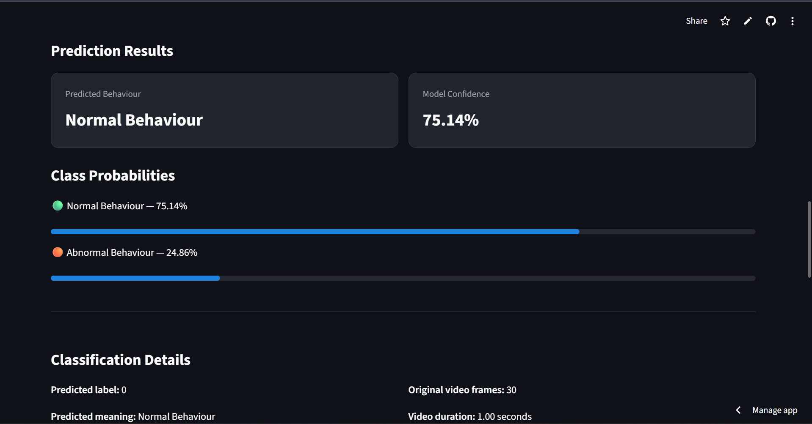

# DCSASS - Video Anomaly Detection

A deep learning project for classifying video clips into **Normal Behaviour** and **Abnormal Behaviour** using a MobileNetV2 feature extractor and a Bidirectional LSTM (BiLSTM) classifier.

The project includes a Streamlit application that allows users to upload a video and view the model's prediction.

## Live Demo

**Try the application:** https://video-anomaly-detection.streamlit.app/

**Source Code:** https://github.com/SarayuNarra/dcsass-video-anomaly-detection

The application allows users to upload a video and receive one of two predictions:

- Normal Behaviour
- Abnormal Behaviour

The application is deployed using Streamlit Community Cloud.

## Application Preview

The following screenshot shows an example prediction generated by the deployed application.



**Example prediction:**
- Predicted class: Normal Behaviour
- Model confidence: 75.14%
- Normal Behaviour probability: 75.14%
- Abnormal Behaviour probability: 24.86%

*These values represent one sample inference, not overall model evaluation metrics.*

## Project Overview

Video anomaly detection aims to identify unusual or potentially abnormal activities in video footage.

This project uses a deep learning pipeline to extract visual features from video frames and analyze their temporal patterns.

## Model Architecture

The pipeline consists of:

1. **Video preprocessing** — Sample 16 frames from an uploaded video.
2. **Feature extraction** — Use MobileNetV2 to extract 1,280-dimensional features from each frame.
3. **Feature projection** — Project extracted features into a 128-dimensional representation.
4. **Temporal learning** — Use a Bidirectional LSTM to learn patterns across video frames.
5. **Classification** — Predict one of two classes:
   - Class 0: Normal Behaviour
   - Class 1: Abnormal Behaviour

### Architecture Configuration

| Component | Configuration |
|---|---|
| Feature extractor | MobileNetV2 |
| Input feature dimension | 1,280 |
| Number of sampled frames | 16 |
| Projection dimension | 128 |
| Recurrent network | Bidirectional LSTM |
| Hidden dimension | 64 |
| LSTM layers | 1 |
| Dropout | 0.4 |
| Output classes | 2 |

## Project Structure

```text
DCSASS-Dataset/
│
├── app.py
├── README.md
├── requirements.txt
├── .gitignore
│
├── model_outputs_experiment2/
│   ├── best_model.pth
│   ├── normalization.npz
│   ├── training_history.csv
│   └── training_summary.json
│
└── research/
    ├── compare_experiments.py
    ├── evaluate_final_test.py
    ├── extract_features.py
    ├── split_dataset.py
    ├── train_gru_v5.py
    ├── train_lstm_v2.py
    ├── train_lstm_v3.py
    ├── train_lstm_v4.py
    ├── verify_existing_arrays.py
    └── verify_labels.py
```

## Installation

### 1. Clone the repository

```bash
git clone https://github.com/SarayuNarra/dcsass-video-anomaly-detection.git
cd dcsass-video-anomaly-detection
```

### 2. Create a virtual environment

```bash
python -m venv .venv
```

Activate it on Windows:

```powershell
.venv\Scripts\Activate.ps1
```

### 3. Install dependencies

```bash
pip install -r requirements.txt
```

## Run the Application

Start the Streamlit application:

```bash
streamlit run app.py
```

Open the local URL displayed in your terminal.

Upload a supported video file to receive a model prediction.

## Model Artifacts

The application uses the following saved files:

- `best_model.pth` — Trained classification model weights.
- `normalization.npz` — Saved normalization parameters.
- `training_history.csv` — Training history.
- `training_summary.json` — Experiment configuration and summary.

These artifacts are required for inference.

## Research and Experiments

The `research/` directory contains scripts for:

- Feature extraction
- Dataset splitting
- LSTM and GRU experiments
- Experiment comparison
- Final test evaluation
- Label verification

## Dataset

This project uses the DCSASS video anomaly detection dataset.

**Note:** Dataset videos and intermediate feature arrays are not included in this repository. Users must obtain the dataset separately and comply with its applicable usage and redistribution terms.

## Current Status

- [x] Model training experiment completed
- [x] Model checkpoint saved
- [x] Streamlit application implemented
- [x] Local inference tested
- [x] GitHub publication
- [x] Cloud deployment
- [x] Cloud inference tested
- [ ] Final test metrics documented

## Future Improvements

- Improve model generalization.
- Evaluate performance on unseen videos.
- Add detailed evaluation metrics.
- Optimize inference speed.

## Disclaimer

This is an experimental machine learning project. Its predictions should not be treated as definitive evidence of abnormal or criminal activity.