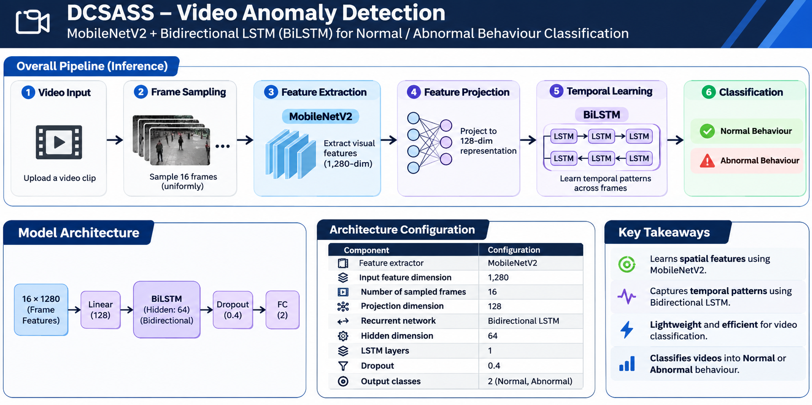

# Video Anomaly Detection using CNN-BiLSTM

An end-to-end deep learning project for classifying video clips as **Normal Behaviour** or **Abnormal Behaviour** using MobileNetV2 feature extraction and a Bidirectional LSTM (BiLSTM).

The project includes model training, independent test evaluation, and a Streamlit web application for video-based predictions.

## 🚀 Live Demo

- **Live Application:** https://video-anomaly-detection.streamlit.app/
- **GitHub Repository:** https://github.com/SarayuNarra/dcsass-video-anomaly-detection

## 📌 Project Overview

Video anomaly detection is a computer vision task that aims to identify unusual or potentially abnormal activities in video footage.

This project explores a deep learning approach that combines:

- **MobileNetV2:** Extracts visual features from video frames.
- **BiLSTM:** Learns temporal patterns across extracted frame features.
- **Fully Connected Classifier:** Predicts normal or abnormal behaviour.

The trained model is integrated into a Streamlit application where users can upload a video and view the prediction.

## 🏗️ Model Architecture



### Architecture Workflow

1. Input video
2. Sample 16 frames from the video
3. Extract visual features using MobileNetV2
4. Project extracted features into a lower-dimensional representation
5. Learn temporal patterns using Bidirectional LSTM
6. Apply mean pooling
7. Classify the video into Normal or Abnormal Behaviour

### Model Configuration

| Component | Configuration |
|---|---|
| Feature Extractor | MobileNetV2 |
| Input Feature Dimension | 1280 |
| Projection Dimension | 128 |
| Recurrent Network | Bidirectional LSTM |
| Hidden Dimension | 64 |
| LSTM Layers | 1 |
| Dropout | 0.4 |
| Sequence Length | 16 |
| Output Classes | 2 |

## 📊 Final Test Results

The selected CNN-BiLSTM Experiment 2 checkpoint was evaluated on the test dataset.

| Metric | Test Result |
|---|---:|
| Accuracy | 57.84% |
| Precision | 49.07% |
| Recall | 61.44% |
| F1-Score | 54.56% |
| Macro F1 | 57.62% |
| Balanced Accuracy | 58.38% |
| ROC-AUC | 0.5859 |

### Test Dataset Information

| Description | Count |
|---|---:|
| Total Test Videos | 2,493 |
| Normal Behaviour (Class 0) | 1,466 |
| Abnormal Behaviour (Class 1) | 1,027 |
| Source Groups | 78 |

### Confusion Matrix

| Actual / Predicted | Normal (0) | Abnormal (1) |
|---|---:|---:|
| Normal (0) | 811 | 655 |
| Abnormal (1) | 396 | 631 |

### Category-Wise Evaluation

| Category | Videos | Accuracy | F1-Score |
|---|---:|---:|---:|
| Abuse | 288 | 53.47% | 0.5000 |
| Arrest | 64 | 15.62% | 0.0000 |
| Arson | 288 | 51.04% | 0.4982 |
| Assault | 64 | 48.44% | 0.4590 |
| Burglary | 160 | 74.38% | 0.8075 |
| Explosion | 160 | 53.12% | 0.3243 |
| Fighting | 32 | 56.25% | 0.3000 |
| RoadAccidents | 286 | 65.73% | 0.3467 |
| Robbery | 511 | 61.06% | 0.6490 |
| Shooting | 96 | 72.92% | 0.6667 |
| Shoplifting | 64 | 60.94% | 0.1935 |
| Stealing | 224 | 52.68% | 0.6045 |
| Vandalism | 256 | 58.98% | 0.5024 |

**Evaluation observations:**

- Overall test performance indicates that the model has significant room for improvement.
- Performance varies considerably across activity categories.
- Arrest detection was particularly weak.
- The results highlight the challenges of learning reliable temporal patterns from video data.

These results are reported from the completed test evaluation and should not be interpreted as production-level performance.

## 🖥️ Application Preview


The Streamlit application allows users to:

- Upload a video.
- Process video frames.
- Generate a model prediction.
- View the predicted behaviour class.
- View prediction confidence and class probabilities.

*Prediction confidence is specific to an individual video and is not the same as overall model accuracy.*

## 📁 Project Structure

```text
DCSASS Dataset/
│
├── app.py
├── requirements.txt
├── README.md
├── .gitignore
│
├── assets/
│   ├── prediction-result.png
│   └── model-architecture.png
│
├── model_outputs_experiment2/
│   ├── best_model.pth
│   ├── normalization.npz
│   ├── training_history.csv
│   └── training_summary.json
│
└── research/
    ├── compare_experiments.py
    ├── evaluate_final_test.py
    ├── extract_features.py
    ├── split_dataset.py
    ├── train_gru_v5.py
    ├── train_lstm_v2.py
    ├── train_lstm_v3.py
    ├── train_lstm_v4.py
    ├── verify_existing_arrays.py
    └── verify_labels.py
```

The dataset and intermediate feature files are not included in the GitHub repository.

## ⚙️ Installation and Usage

### 1. Clone the repository

```bash
git clone https://github.com/SarayuNarra/dcsass-video-anomaly-detection.git
cd dcsass-video-anomaly-detection
```

### 2. Create a virtual environment

```bash
python -m venv venv
```

Activate it:

**Windows:**

```bash
venv\Scripts\activate
```

**Linux / macOS:**

```bash
source venv/bin/activate
```

### 3. Install dependencies

```bash
pip install -r requirements.txt
```

### 4. Run the application

```bash
streamlit run app.py
```

Open the local URL displayed in your terminal.

## 📦 Dataset

This project uses the DCSASS dataset.

Dataset source:

https://www.kaggle.com/datasets/mateohervas/dcsass-dataset

Please refer to the original dataset page for its licensing and usage conditions. The dataset is not redistributed in this repository.

## 🧪 Evaluation Artifacts

The final evaluation script generates:

- `final_test_category_results.csv` — category-wise evaluation metrics.
- `final_test_predictions.csv` — individual test predictions.
- `final_test_summary.json` — overall evaluation summary.

These files are generated when running:

```bash
python research/evaluate_final_test.py
```

The test evaluation uses the saved Experiment 2 normalization parameters and model checkpoint.

## ✅ Project Status

- [x] Dataset preparation and preprocessing
- [x] Feature extraction using MobileNetV2
- [x] CNN-BiLSTM model implementation
- [x] Model training experiment completed
- [x] Model checkpoint saved
- [x] Streamlit application implemented
- [x] Local inference tested
- [x] GitHub publication
- [x] Cloud deployment
- [x] Cloud inference tested
- [x] Final test evaluation completed
- [x] Final test metrics documented

## 🔮 Future Improvements

- Improve abnormal activity detection.
- Investigate class imbalance and category-wise performance.
- Experiment with alternative temporal architectures.
- Improve feature extraction and video preprocessing consistency.
- Perform further validation and error analysis.
- Evaluate model performance on additional video datasets.

## ⚠️ Disclaimer

This project is an educational and experimental deep learning implementation. Its current performance is not sufficient to support real-world security or surveillance decisions. Predictions should not be treated as verified evidence of abnormal activity.

## 👨‍💻 Author

Developed as a hands-on project to explore Deep Learning, Computer Vision, video feature extraction, temporal modeling, model evaluation, and deployment.